<div align="center">

# manan-kanchu — AI Code Detector

**Detect AI-generated code, scan for vulnerabilities, audit security policies and protect your codebase — all inside VS Code.**

[](LICENSE)
[](https://marketplace.visualstudio.com/items?itemName=sergioide007.manan-kanchu-code-ai)
[](CHANGELOG.md)
[](https://github.com/sergioide007/manan-kanchu-code-ai/actions/workflows/ci.yml)
[](PRIVACY.md)

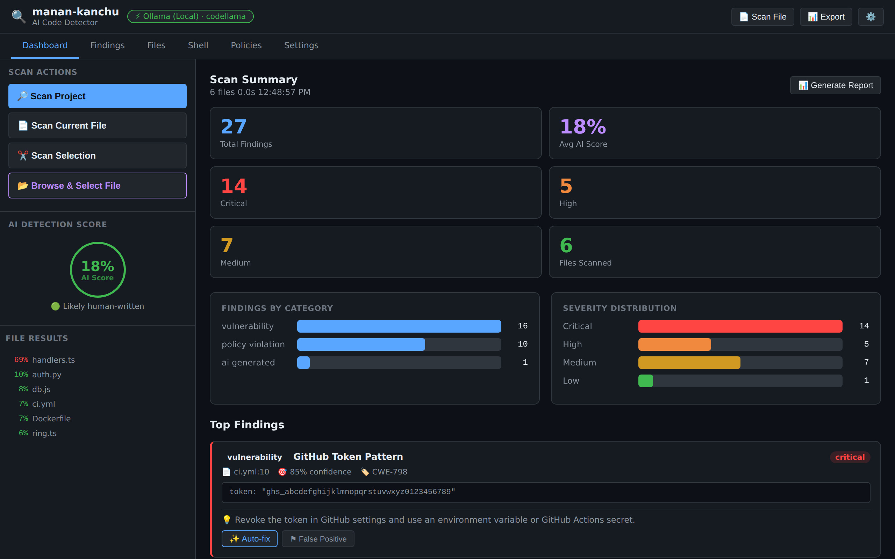

<sub>Screenshots show the real dashboard rendered with sample data from a demo project.
Prefer motion? See the animated demos: [dashboard](https://raw.githubusercontent.com/sergioide007/manan-kanchu-code-ai/main/media/dashboard-overview.gif) · [project scan](https://raw.githubusercontent.com/sergioide007/manan-kanchu-code-ai/main/media/scan-project.gif).</sub>

</div>

---

## Table of contents

- [What is manan-kanchu?](#what-is-manan-kanchu)
- [How it works](#how-it-works)
- [Features](#features)
- [Quick start](#quick-start)
- [Commands & shortcuts](#commands--shortcuts)
- [AI providers](#ai-providers)
- [Settings reference](#settings-reference)
- [Architecture](#architecture)
- [Privacy & data flow](#privacy--data-flow)
- [Limitations & responsible use](#limitations--responsible-use)
- [Contributing](#contributing)
- [Author & contact](#author--contact)
- [License](#license)

---

## What is manan-kanchu?

**manan-kanchu** (*mah-nan-KAHN-chu*) is a Quechua expression meaning *"there isn't"* — the extension looks for what shouldn't be there: AI-generated code passed off as human work, insecure patterns, and malicious payloads.

It combines **heuristic analysis** with optional **multi-provider AI analysis** in a security and code-quality dashboard that lives inside VS Code.

| | |
|---|---|
| 🔍 **Detect** | Hybrid AI-authorship scoring per file, with the evidence behind every score |
| 🛡️ **Scan** | 91 vulnerability patterns (with CWE codes) and 7 categories of malicious code |
| 📋 **Audit** | 14 built-in policy rules plus your own custom rules |
| 🔒 **Private** | Open source (MIT). Code goes only to *your* chosen provider — there are no manan-kanchu servers |

---

## How it works

Every scan runs your code through independent engines and consolidates the results in one dashboard, which can be exported as a Markdown report.

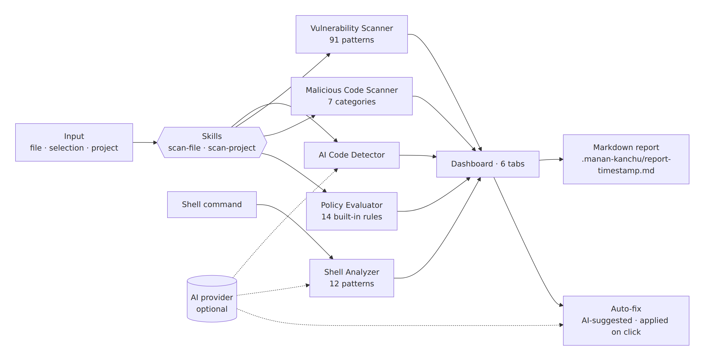

---

## Features

### 1. AI Code Detection

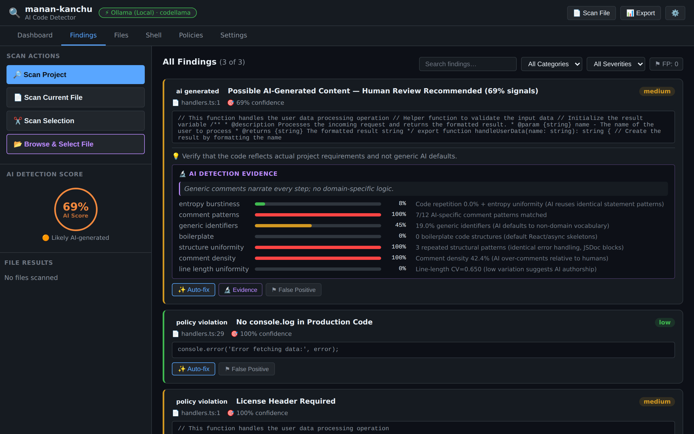

Seven heuristic signals (comment patterns and density, generic identifiers, boilerplate, structural uniformity, entropy, line-length variance) are blended with an AI semantic score. Default weights are **40% heuristic / 60% AI**; they are normalised, so custom values never have to sum to 1.

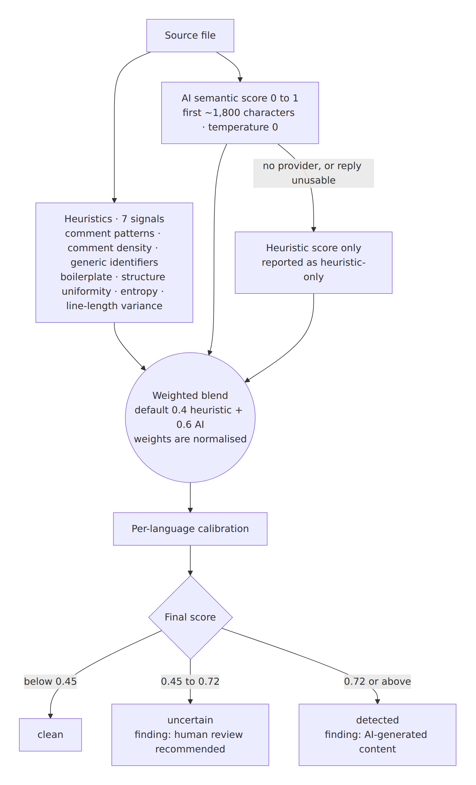

| Final score | Tier | What you get |
| --- | --- | --- |
| below 0.45 | `clean` | no finding |
| 0.45 – 0.72 | `uncertain` | finding: *human review recommended* |
| 0.72 and above | `detected` | finding: *AI-generated content* |

Without an AI provider the score is computed from the heuristics alone and reported as `heuristic-only`.

### 2. Vulnerability Scanner

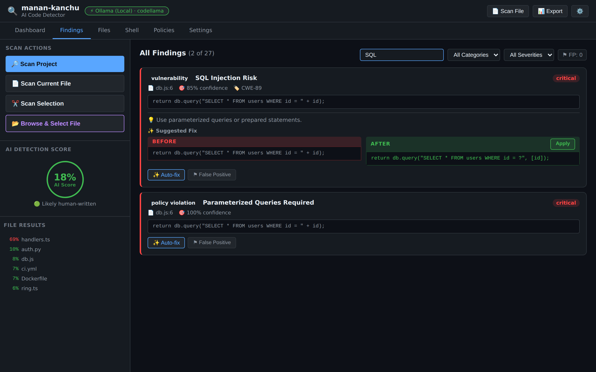

**91 patterns**, reported with CWE codes, across application code, infrastructure and pipelines:

| Area | Examples |
| --- | --- |
| Injection | SQL, command and code injection (`eval`, `exec`, `Function`), unsafe deserialization (`pickle`, `Marshal`, `ObjectInputStream`) |
| Web | `innerHTML`, `dangerouslySetInnerHTML`, `document.write`, open redirects, prototype pollution |
| Secrets | Hardcoded passwords and API keys; **AWS, Google, GitHub, Slack and Azure keys; private-key blocks** |
| Crypto | MD5/SHA-1, insecure random for tokens, disabled TLS verification |
| Memory safety | `gets`, `strcpy`, `sprintf`, `scanf %s`, `unsafe` blocks |
| Infrastructure | Terraform, Dockerfile, Kubernetes manifests |
| CI/CD | Hardcoded pipeline secrets, `curl \| bash`, risky `pull_request_target` |

Languages: JavaScript/TypeScript, Python, Java, C#, C/C++, PHP, Go, Ruby, Rust, Kotlin, Swift, Scala, Dart and shell.

### 3. Malicious Code Scanner

Seven categories, useful when auditing third-party code and supply-chain risk:

- **Keyloggers** — key listeners combined with network calls
- **Data exfiltration** — credential, `localStorage` and cookie theft, hidden iframes
- **Form hijacking** — submit interception and input harvesting (web skimmers)
- **Crypto miners** — CoinHive-style libraries, WebAssembly loaded from outside
- **Clipboard hijacking** — silent replacement of copied content
- **Obfuscation** — `eval(atob(...))`, long hex-encoded payloads
- **Tracking** — fingerprinting data sent to a server

### 4. Policy Evaluator

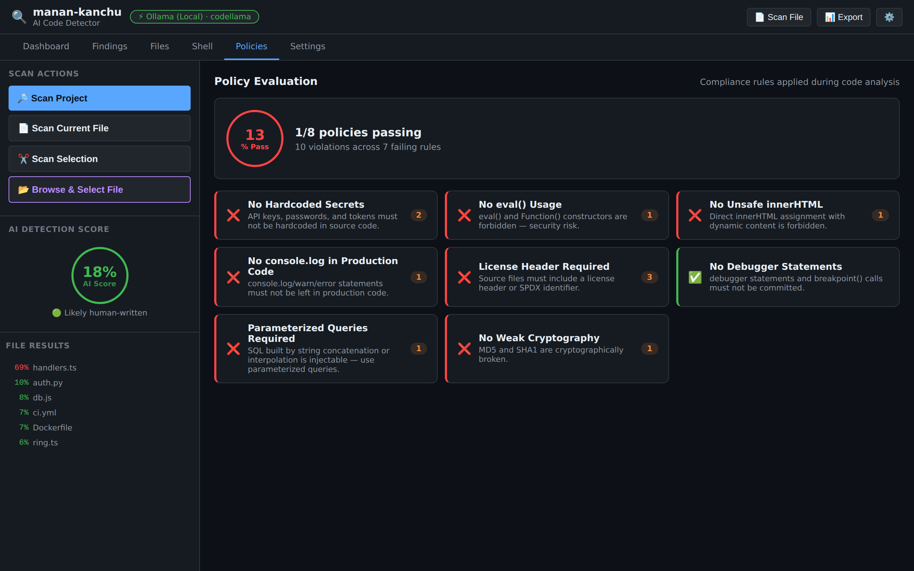

14 built-in rules. Four are active by default (✅); enable the rest with the `manan-kanchu.policies` setting, or add your own rules.

| Rule ID | Description | Default |
| --- | --- | :---: |
| `no-hardcoded-secrets` | No API keys or passwords in source files | ✅ |
| `no-eval` | `eval()` / `new Function()` forbidden | ✅ |
| `no-innerHTML` | No direct `innerHTML` assignment | ✅ |
| `license-compliance` | License header or SPDX identifier in source files | ✅ |
| `no-sql-injection` | SQL built by concatenation/interpolation is flagged | |
| `no-weak-crypto` | MD5 and SHA-1 forbidden | |
| `gdpr-personal-data-logging` | No PII in log statements | |
| `no-console-log` | No `console.*` left in production code | |
| `no-debugger` | No `debugger`, `breakpoint()` or `pdb.set_trace()` | |
| `no-todo-comments` | No unresolved `TODO` / `FIXME` comments | |
| `no-http-external` | External URLs must use HTTPS | |
| `no-any-typescript` | No TypeScript `any` | |
| `no-async-without-await` | `async` functions must use `await` | |
| `no-synchronous-fs` | No `fs.*Sync` calls | |

### 5. Shell Command Analyzer

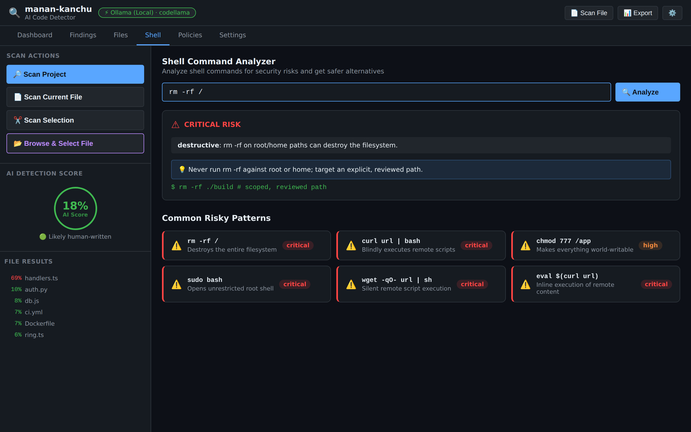

Paste a command and get an instant risk assessment from 12 patterns:

- **Destructive** — `rm -rf` on root/home paths (also `rm -r -f`, `--force`), `dd` from `/dev/zero` or `/dev/urandom`, writes to raw disks, `truncate`
- **Remote execution** — `curl | bash`, `wget | sh`
- **Privilege escalation** — `sudo bash`, world-writable `chmod` (777, 666, `a+w`), `crontab` edits
- **Exfiltration** — sensitive files sent over the network, reverse SSH tunnels

With an AI provider configured you also get a tailored tip and a safer version of the command.

### 6. Audit Dashboard

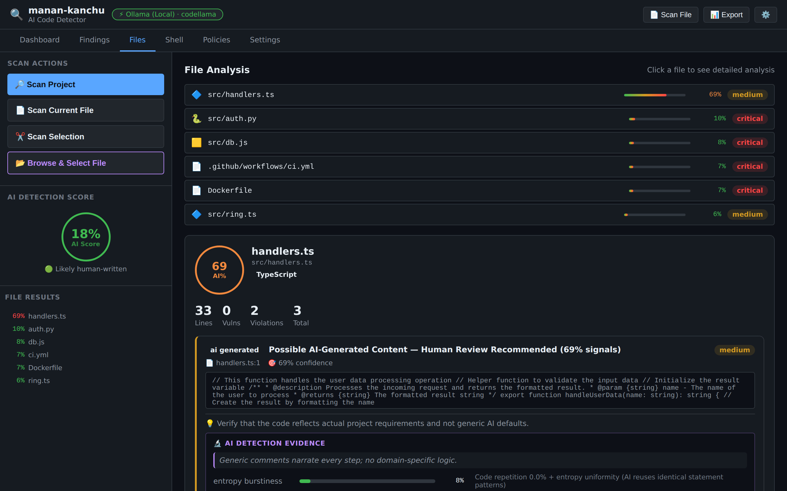

A dark-theme WebviewPanel with 6 tabs:

| Tab | Content |
| --- | --- |
| **Dashboard** | Scan summary, severity charts, top findings |
| **Findings** | Every finding, filterable by category and severity, with *Auto-fix* and *False positive* actions |
| **Files** | Per-file AI score, vulnerabilities and policy violations, with drill-down |
| **Shell** | Shell command analyzer |
| **Policies** | Pass/fail grid and compliance percentage |
| **Settings** | Detection threshold and AI provider configuration |

Export the full audit as Markdown to `.manan-kanchu/report-<timestamp>.md`. Add `.manan-kanchu/` to your `.gitignore` so reports are not committed by accident.

---

## Quick start

### 1. Install

Search **"manan-kanchu"** in the Extensions panel (`Ctrl+Shift+X`), or run:

```bash
code --install-extension sergioide007.manan-kanchu-code-ai
```

### 2. (Optional) configure an AI provider

The scanners work without one. To enable AI detection scoring, shell tips and auto-fix, press `Ctrl+Shift+M` → **Configure AI Provider**.

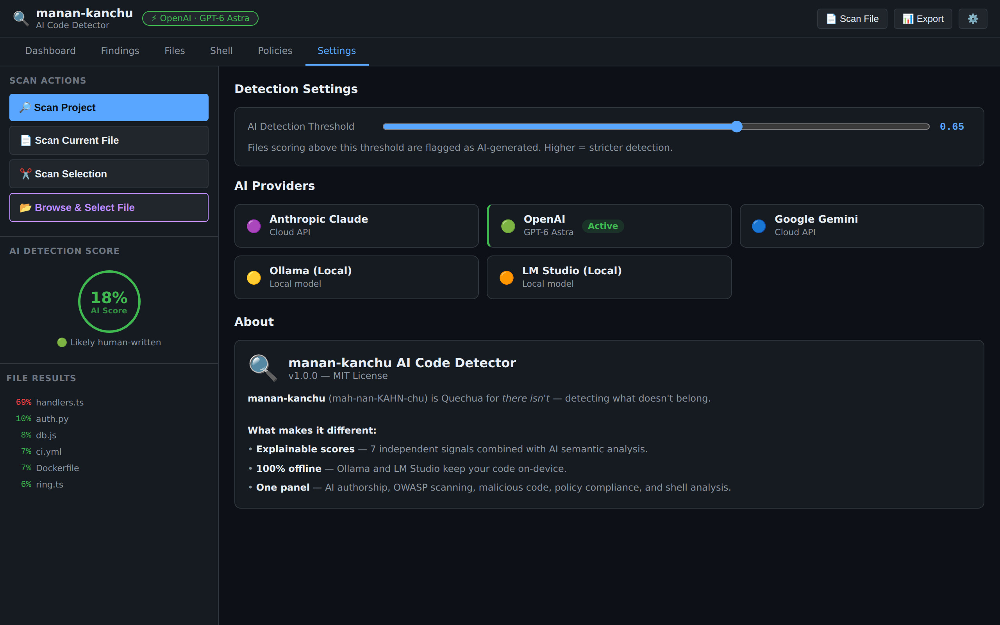

**Local (free, fully private):**

```bash
# Ollama — auto-detected at http://localhost:11434
ollama pull codellama

# LM Studio — auto-detected at http://localhost:1234
# Load any model and start the local server
```

**Cloud:** pick Anthropic, Google Gemini or OpenAI and paste your API key. Keys live in the OS keychain through VS Code `SecretStorage` — never in `settings.json`. To remove a stored key, run **Configure AI Provider**, pick the provider and submit an empty key.

### 3. Open the dashboard and scan

| Shortcut (`Cmd` instead of `Ctrl` on macOS) | Action |
| --- | --- |
| `Ctrl+Alt+M` | Open the dashboard |
| `Ctrl+Alt+S` | Scan the current file |
| `Ctrl+Shift+M` | Quick command menu |

You can also click **Scan Project** in the dashboard, right-click a file → **Scan Current File**, or select code → right-click → **Scan Selected Code**.

---

## Commands & shortcuts

| Command | Shortcut | Description |
| --- | --- | --- |
| `manan-kanchu: Open Dashboard` | `Ctrl+Alt+M` | Open the main analysis panel |
| `manan-kanchu: Show Commands` | `Ctrl+Shift+M` | Quick menu with the main commands |
| `manan-kanchu: Scan Current File` | `Ctrl+Alt+S` | Analyze the active editor file |
| `manan-kanchu: Scan Entire Project` | — | Scan every source file in the workspace |
| `manan-kanchu: Scan Selected Code` | — | Analyze the highlighted selection |
| `manan-kanchu: Generate Audit Report` | — | Export a Markdown report to the workspace |
| `manan-kanchu: Configure AI Provider` | — | Pick a provider and store or remove its API key |
| `manan-kanchu: Sanitize Detected Issues` | — | Points you to the dashboard, where **Auto-fix** on any finding proposes and applies a fix |

---

## AI providers

| Provider | Type | Where your code goes | Cost |
| --- | --- | --- | --- |
| Ollama | Local | Stays on your machine | Free |
| LM Studio | Local | Stays on your machine | Free |
| Anthropic Claude | Cloud | Direct API call with your key | API pricing |
| Google Gemini | Cloud | Direct API call with your key | API pricing |
| OpenAI GPT | Cloud | Direct API call with your key | API pricing |

### Auto mode (default)

With `manan-kanchu.preferredProvider: auto`, the first provider that is reachable wins, and **local providers always come first**. If you pick a specific provider that is not available, selection falls back to auto.

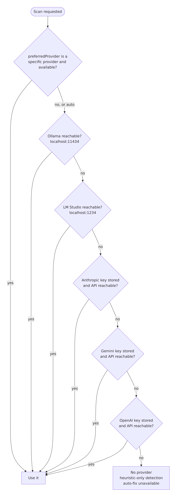

### Default models

| Provider | Setting value | Shown in the dashboard as |
| --- | --- | --- |
| Anthropic | `claude-sonnet-4-6` | Claude Sonnet 4.6 |
| OpenAI | `gpt-6-astra` | GPT-6 Astra |
| Gemini | `gemini-3.1-flash-lite` | Gemini 3.1 Flash-Lite |
| Ollama | `codellama` | codellama |

The dashboard shows the active provider with a readable model name (for example **OpenAI · GPT-6 Astra**); unknown model IDs are shown as typed.

**OpenAI reasoning models** (GPT-5 and later, such as `gpt-6-astra`) are handled automatically: the request uses `max_completion_tokens` with extra headroom for hidden reasoning tokens, a low reasoning effort, and no custom temperature. If a compatible server rejects a parameter, the extension retries without it. GPT-6 Astra is a flagship model — for high-volume project scans, pick a smaller model in `manan-kanchu.openai.model` or use a local provider.

Model names change quickly — set the one you prefer in the settings below.

---

## Settings reference

<details>
<summary><b>Show all settings</b></summary>

| Setting | Default | Description |
| --- | --- | --- |
| `manan-kanchu.preferredProvider` | `auto` | `auto`, `anthropic`, `openai`, `gemini`, `ollama` or `lmstudio` |
| `manan-kanchu.anthropic.model` / `.baseUrl` | `claude-sonnet-4-6` / `https://api.anthropic.com/v1` | Anthropic model and API base URL |
| `manan-kanchu.openai.model` / `.baseUrl` | `gpt-6-astra` / `https://api.openai.com/v1` | OpenAI model and API base URL. Any OpenAI-compatible server works through `baseUrl` |
| `manan-kanchu.gemini.model` / `.baseUrl` | `gemini-3.1-flash-lite` / `https://generativelanguage.googleapis.com/v1beta` | Gemini model and API base URL |
| `manan-kanchu.ollama.endpoint` / `.model` | `http://localhost:11434` / `codellama` | Ollama server and model |
| `manan-kanchu.lmstudio.endpoint` | `http://localhost:1234` | LM Studio server |
| `manan-kanchu.detection.threshold` | `0.65` | Files at or above this score count as *AI-generated* in project summaries and reports. Per-file tiers use the fixed 0.45 / 0.72 cut-offs described above |
| `manan-kanchu.detection.heuristicWeight` | `0.4` | Weight of the heuristic score (normalised against `aiWeight`) |
| `manan-kanchu.detection.aiWeight` | `0.6` | Weight of the AI semantic score |
| `manan-kanchu.scan.excludePatterns` | `node_modules, dist, out, .git, *.min.js, *.min.css` | Names/globs skipped in project scans. `node_modules`, `.git`, `coverage`, `build`, `dist`, `out` and `.next` are always skipped |
| `manan-kanchu.scan.maxFileSizeKB` | `512` | Larger files are skipped |
| `manan-kanchu.policies` | `no-hardcoded-secrets, no-eval, no-innerHTML, license-compliance` | Active policy rule IDs |
| `manan-kanchu.requestTimeout` | `120000` | AI request timeout in ms |
| `manan-kanchu.maxTokens` | `4096` | **Ceiling** on tokens per AI request. Each feature asks for what it needs (score: 80, shell tip: 200, auto-fix: 1,024) and is capped at this value |
| `manan-kanchu.temperature` | `0.1` | Sampling temperature for **every** AI request, 0–1. Lower is more consistent; 0–0.2 is recommended for analysis. Models that don't accept a custom temperature (such as GPT-6 Astra) ignore it |
| `manan-kanchu.privacy.telemetry` | `false` | Reserved. The extension sends no telemetry |

</details>

```jsonc
{
  "manan-kanchu.preferredProvider": "ollama",
  "manan-kanchu.policies": ["no-hardcoded-secrets", "no-eval", "no-sql-injection", "no-debugger"],
  "manan-kanchu.scan.excludePatterns": ["node_modules", "dist", "out", "coverage"]
}
```

---

## Architecture

The extension is layered: **entry point → panel → skills → analyzers → providers**. Analyzers are pure functions of the code you give them, so they are easy to test. Every read and write of a project file inside the workspace (scans, reports, file previews, *Apply fix*) goes through the **Filesystem MCP** server, which refuses any path that escapes the workspace.

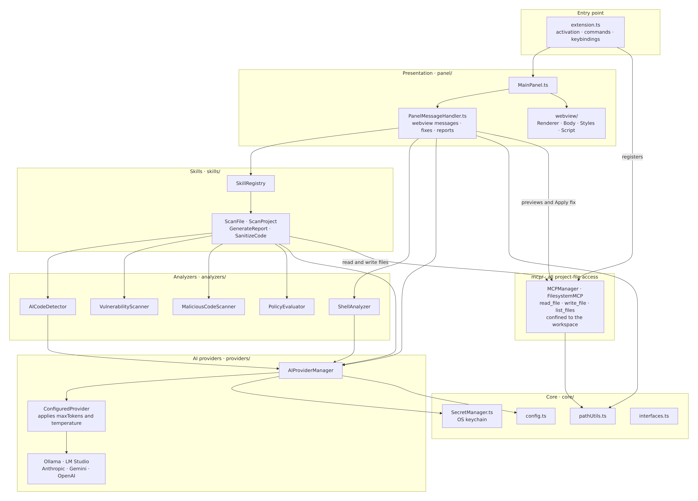

### Scan lifecycle

What happens when you scan the current file:

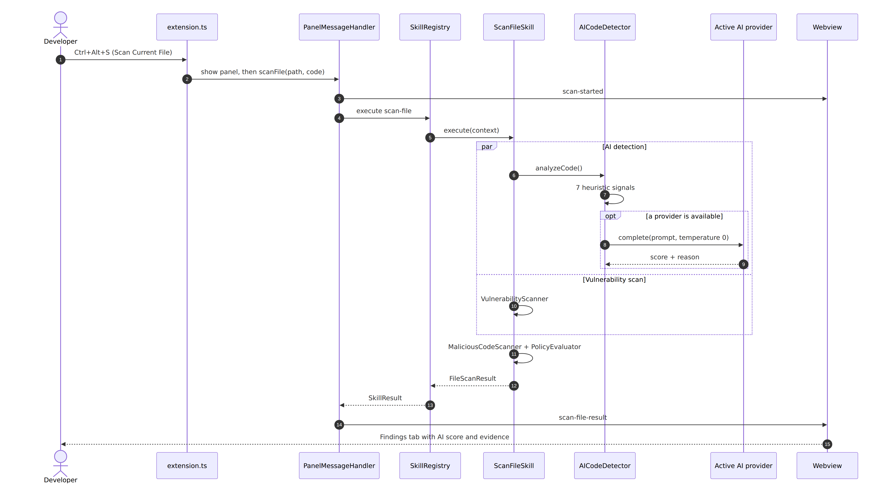

<details>
<summary><b>Project structure</b></summary>

```
src/
├── extension.ts                 ← Activation, commands, keybindings
├── core/
│   ├── interfaces.ts            ← Shared TypeScript types
│   ├── config.ts                ← Settings manager
│   ├── SecretManager.ts         ← API keys in the OS keychain
│   ├── pathUtils.ts             ← Workspace-safe path resolution
│   └── modelNames.ts            ← Friendly model labels
├── providers/
│   ├── AIProviderManager.ts     ← Selection order, key removal
│   ├── ConfiguredProvider.ts    ← Applies the maxTokens / temperature settings
│   └── Anthropic · OpenAI · Gemini · Ollama · LMStudio providers
├── analyzers/
│   ├── AICodeDetector.ts        ← Heuristics + AI blend
│   ├── VulnerabilityScanner.ts  ← 91 patterns
│   ├── MaliciousCodeScanner.ts  ← 7 categories
│   ├── PolicyEvaluator.ts       ← 14 built-in rules
│   ├── ShellAnalyzer.ts         ← 12 patterns
│   └── utils.ts
├── panel/
│   ├── MainPanel.ts             ← WebviewPanel host
│   ├── PanelMessageHandler.ts   ← Webview ↔ extension messages
│   └── webview/                 ← Renderer, Body, Styles, Script
├── skills/                      ← SkillRegistry, ScanFile, ScanProject, GenerateReport, SanitizeCode
└── mcp/                         ← MCPManager, FilesystemMCP, workspaceFiles (workspace-confined file access)
```

Diagram sources live in [`docs/diagrams`](docs/diagrams) as Mermaid files.

</details>

---

## Privacy & data flow

- **No telemetry** and **no manan-kanchu servers**.
- The **dashboard makes no network requests**: no web fonts, no CDNs, and a strict content-security policy.
- **API keys** are stored in the OS keychain and can be removed from the extension.
- **Only snippets reach a provider, and only the one you chose**: about the first 1,800 characters of a file for AI detection, at most 3,000 characters of surrounding code plus the flagged line for an auto-fix, and the command text for shell tips.
- **Local providers** (Ollama, LM Studio) keep everything on your machine.

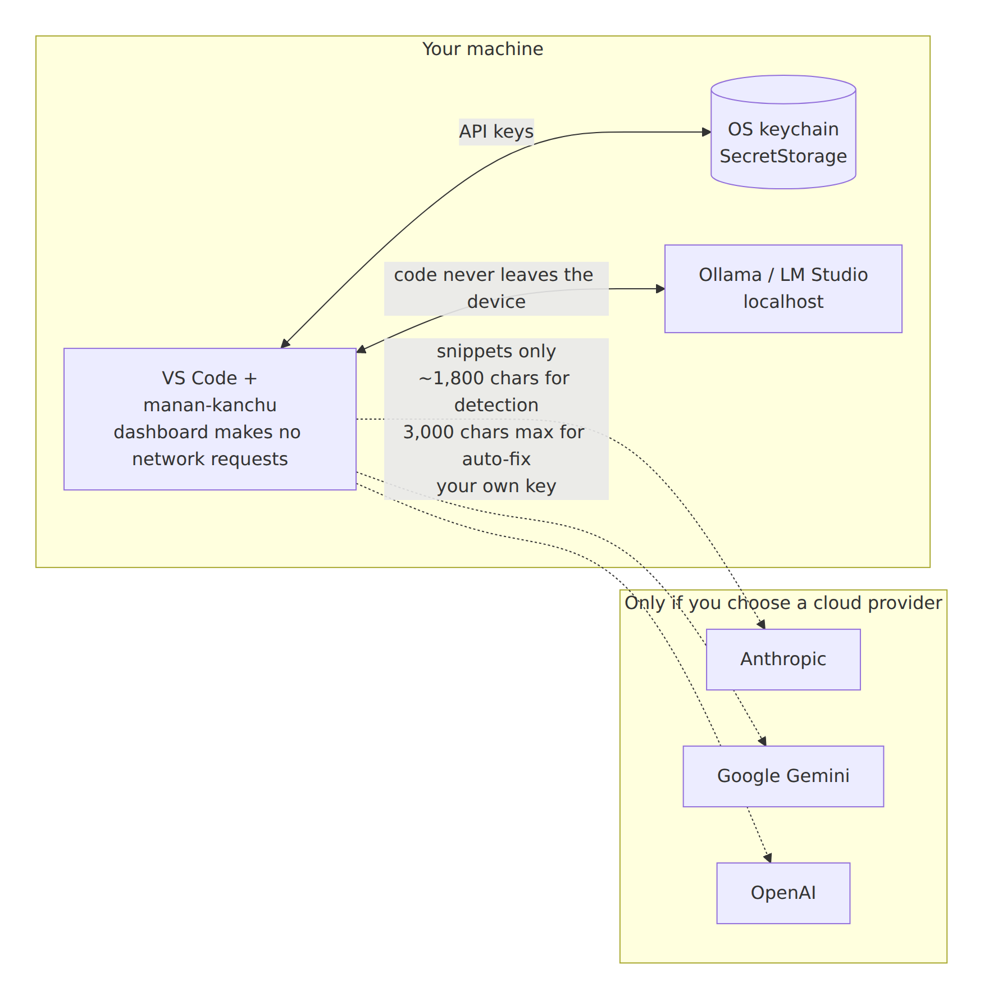

See [PRIVACY.md](PRIVACY.md) for the full policy.

---

## Limitations & responsible use

- **AI-authorship detection is probabilistic.** A score is an indicator, not proof of who wrote the code. False positives and negatives happen, especially with short files, boilerplate-heavy code, and code shaped by strict style guides or formatters.
- **Never use the score as the sole basis** for academic, disciplinary, employment or contractual decisions.
- **Scanners are pattern-based.** They are not a substitute for a security review, a SAST/DAST pipeline or a dependency audit. To reduce noise, matches that sit inside a string literal on the same line are ignored (secret detectors are exempt).
- **Project scans** skip hidden folders (except `.github`, `.circleci` and `.gitlab-ci.yml`), files over the size limit and unsupported extensions.
- **Cloud providers receive the code snippets they analyze.** Use a local provider for sensitive or proprietary code.
- **Review AI-suggested fixes** before applying them — *Apply* rewrites the file on disk (only inside the workspace).

---

## Contributing

Contributions are welcome — see [CONTRIBUTING.md](CONTRIBUTING.md).

```bash
git clone https://github.com/sergioide007/manan-kanchu-code-ai
cd manan-kanchu-code-ai
npm ci
npm run compile
npm test        # 154 tests
npm run lint
```

Press **F5** in VS Code to launch the Extension Development Host. Recording screenshots? See [docs/CONTRIBUTING-MEDIA.md](docs/CONTRIBUTING-MEDIA.md).

---

## Author & contact

Built by **Sergio Perez Ruiz**, Senior Software Engineer and author of *Código Sintético* (Spanish) / *Synthetic Code* (English).

| Channel | Use it for |
|---|---|
| Email: [sergio@specsolid.com](mailto:sergio@specsolid.com) · [sergioide007@gmail.com](mailto:sergioide007@gmail.com) | Direct contact, collaborations, privacy requests |
| [LinkedIn](https://www.linkedin.com/in/sergioide007/) | Professional contact and project news |
| [Medium](https://medium.com/@sergioide007) | Articles on SpecSolid and agentic software engineering |
| [YouTube: @codigosinteticolibro](https://www.youtube.com/@codigosinteticolibro) | Videos about the book *Código Sintético* (in Spanish) |
| [GitHub Issues](https://github.com/sergioide007/manan-kanchu-code-ai/issues) | Bugs and feature requests |
| [SECURITY.md](SECURITY.md) | Vulnerabilities: report them privately by email, not in a public issue |

---

## License

MIT — see [LICENSE](LICENSE).
